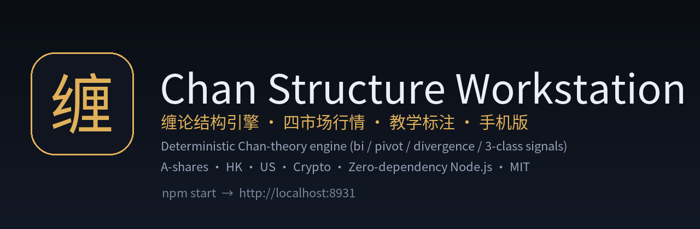
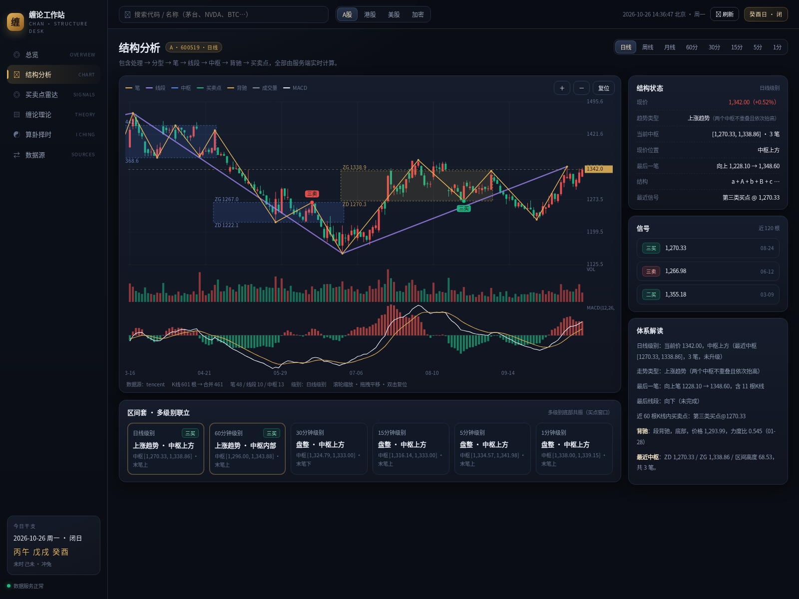
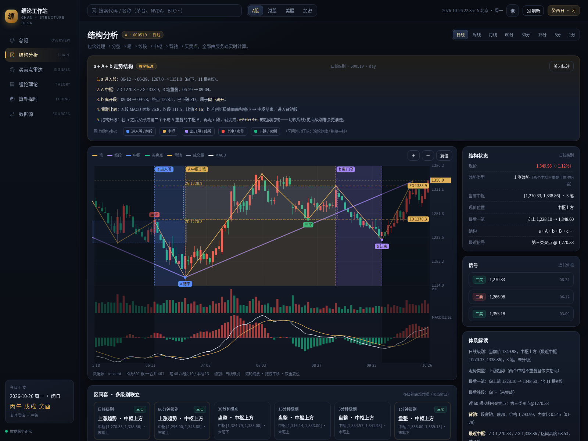
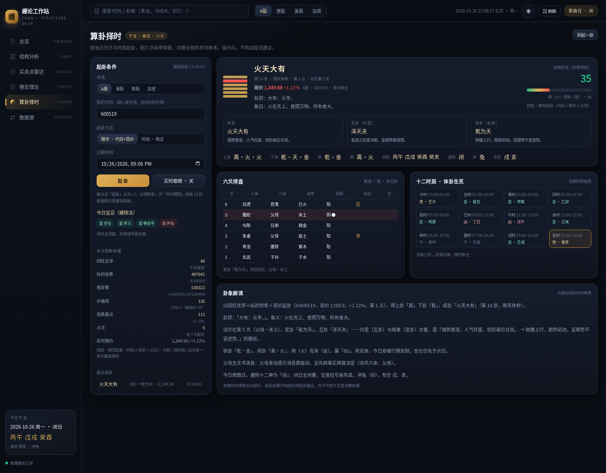
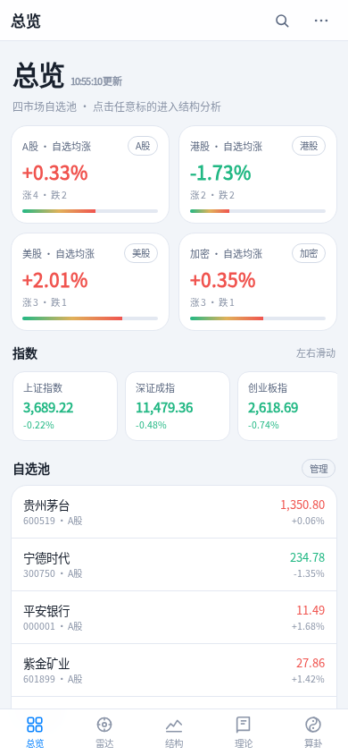
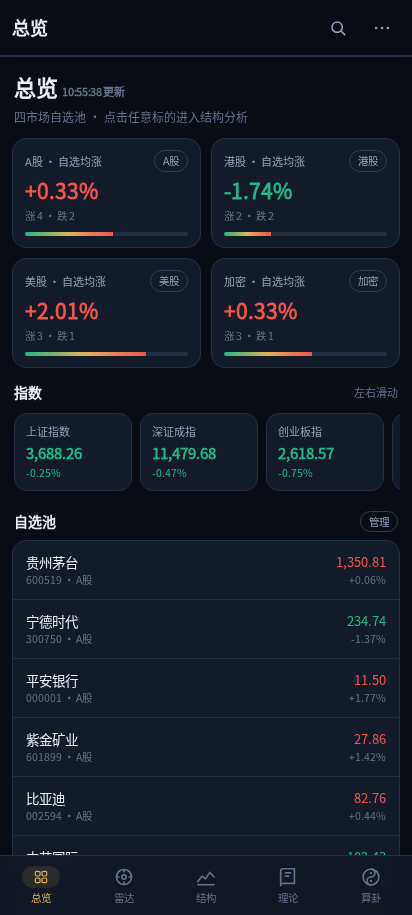

# Chan Structure Workstation · 缠论工作站

**English** · [简体中文](README.zh-CN.md)

<p align="center">
  
</p>

<p align="center">
  <a href="LICENSE"></a>
  <a href="https://nodejs.org"></a>
  
  <a href="#testing"></a>
  <a href="https://huggingface.co/spaces"></a>
</p>

> **A deterministic, dependency-free Chan-theory (缠论) structure engine + multi-market trading workstation.**
> Parse any OHLC series into fractals → strokes → segments → pivots → divergence → 1st/2nd/3rd class buy-sell points, see exactly where each concept lives on the chart, and run the same engine over A-shares, HK, US stocks and crypto.

<p align="center">
  
</p>

---

## Why this exists

Chan theory (缠中说禅 / "Chan Zhong Shuo Chan") is one of the most influential price-structure methodologies in the Chinese-speaking trading world — and one of the worst served by open-source tooling. Existing projects are either black-box screen-recorders, closed indicator packs, or one-off notebooks that break on the next data feed.

This project is the opposite: **a small, readable, deterministic engine** (≈900 lines, zero runtime dependencies) plus a full workstation around it.

| | Typical Chan tools | This project |
| --- | --- | --- |
| Engine | embedded in a closed app / not reproducible | pure JS, deterministic, unit-tested, MIT |
| Dependencies | pandas / TA-Lib / dozens of npm packages | **0** (Node ≥18 standard library only) |
| Markets | one market, one data vendor | A-shares · HK · US · Crypto, multi-source with automatic fallback |
| Explainability | "the algorithm says so" | every band / pivot / signal can be **highlighted and explained on the chart** with real dates, prices and MACD areas |
| Mobile | none | installable PWA with **two native-feeling skins** (iOS / Android) |
| Learning | none | 20 concepts + 14 "where is it on the chart?" Q&A + 108-lesson guide + guided chart annotation |

---

## Features

### 1. Structure engine (`server/lib/chan.js`)

- **Inclusion handling** (K-line merging) → **fractals** → **strokes (笔)** with the strict ≥5-merged-bar rule → **segments (线段)** → **pivots (中枢, ZG/ZD, 9-stroke upgrade flag)**
- **Trend classification** (trend / consolidation from pivot succession)
- **Divergence (背驰)** by comparing MACD histogram area + DIF extremes of same-direction moves (segment-level and stroke-level)
- **Signals**: 1B/2B/3B and 1S/2S/3S with the exact geometric conditions (new extreme + weaker momentum; pullback that does not break the prior low; pullback that does not re-enter the pivot)
- **Multi-level suite** (区间套): run every level from 1m to 1d and detect cross-level resonance
- **Signal backtest**: every buy/sell point type gets a hit rate, average forward return, profit factor and **excess over a random-hold baseline** — with an explicit small-sample warning
- Deterministic: same bars in → same structures out (covered by tests)

```js
const { analyze } = require('./server/lib/chan');

const res = analyze(bars, { period: 'day' });
res.trend;      // { type: '上涨趋势', sub: '两个中枢不重叠且依次抬高' }
res.pivots;     // [{ zg, zd, i0, i1, count, upgraded, … }]
res.beichi;     // [{ kind: '段背驰', dir: -1, areaRatio: 0.55, … }]
res.signals;    // [{ type: '1B', price, barIdx, note, … }]
res.summary;    // human-readable narrative built from the actual numbers
```

> **Honest simplifications** (documented in code and in the UI): segments use the 3-stroke fractal approximation rather than the full feature-sequence gap handling; pivots are stroke-level; divergence is numeric (area-ratio thresholds 0.92 / 0.85). See [docs/ARCHITECTURE.md](docs/ARCHITECTURE.md).

### 2. Four markets, free data, graceful degradation

| Market | Daily / weekly / monthly | Intraday | Realtime quote |
| --- | --- | --- | --- |
| A-shares | Tencent `ifzq.gtimg.cn` (qfq) → Eastmoney → Sina | Sina `CN_MarketDataService` → Tencent mkline | Tencent `qt.gtimg.cn` |
| Hong Kong | Tencent fqkline → Eastmoney | — (UI hides unavailable levels) | Tencent |
| US | Nasdaq official API → Sina US → Eastmoney; week/month aggregated locally | — | Tencent |
| Crypto | Binance `data-api.binance.vision` klines | 1m/5m/15m/30m/1h/4h | Binance ticker/24hr |

No API keys, no paid vendors; per-request timeout + retry + dedup + TTL cache. Details and ToS notes: [docs/DATA_SOURCES.md](docs/DATA_SOURCES.md).

### 3. Teaching annotations — theory → chart, one click

Every concept in the theory library has an **"annotate it on the chart →"** action. The chart dims everything else and draws exactly the structure the concept describes — with real dates, prices and MACD areas from the current chart.

<p align="center">
  
</p>

| Concept | What gets highlighted |
| --- | --- |
| Fractal / stroke | last 3–4 strokes as bands + top/bottom fractal bubbles |
| Segment | last 3 segments, direction and completion state |
| Pivot | the pivot box + ZG/ZD dashed lines + stroke count / 9-stroke upgrade |
| **a+A+b** | entry leg **a**, pivot **A**, exit leg **b**, plus the a-vs-b MACD area ratio verdict |
| Divergence | previous leg vs diverging leg, extreme bubbles, area ratio, 1B/1S meaning |
| 1B / 2B / 3B | divergence leg or pivot + pullback leg + signal bubble + stop reference line |

### 3.5 Timing lab (算卦页新增)

Seven independent timing methods run side by side — **四柱·节气五行 / 梅花易数 / 六爻纳甲 / 建除十二神 / 日历周期因子 / 紫微斗数·流日 / 奇门遁甲·时家** — each returning a 0–100 "顺逆分" with readable reasons, plus a weighted composite, an agreement/spread read-out, and a **per-method historical validation**: for the selected symbol we recompute the score for the last N sessions and correlate it with next-session returns.

The verdict is deliberately blunt: on the shipped sample it usually says *"no significant edge — use it as a discipline tool, not a signal source."* 紫微斗数流日盘（十二宫＋十四主星＋四化）与奇门遁甲时家盘（阴阳遁·局数·三奇六仪·九星·八门·八神）都按同一标准接入：先排盘、再打分、最后必须过 `/api/timing/validate` 的逐日回测。方法卡（理论页 → 择时方法）对每一法都写明局限。

### 4. Trading radar, live refresh, editable watchlist

- Cross-market scan sorted by "signal freshness × type weight"
- Global live mode: quotes every 10s, structure every 20s, radar every 30s
- Add/remove symbols per market (search autocomplete); persisted to `data/watchlist.json`

### 4.4 108-lesson index + lore collection（108课全表 · 言论集）

- **108 课全表**: all 108 lessons with number, theme (14 study-route groups), title **only where verifiable from public indexes** (50), and a one-line gist (24); unverified titles are left blank on purpose — no invented titles. Served by `/api/chan-lessons`.
- **言论集**: 22 curated entries from 天涯论坛 / 新浪博客, each with source, era, kind, takeaway and the concept it maps to (e.g. "同一级别买点买入就在同一级别卖点卖出" → 级别). Clearly labelled as **community paraphrase, not verbatim quotes**: `/api/chan-lore`.

### 4.5 Metaphysics knowledge base (命理知识库)

A first-class module (not a footnote): **天干地支/四柱 · 紫微斗数 · 奇门遁甲 · 梅花易数 · 六爻纳甲**, each with principle, the exact rules this codebase implements, where to look in the UI, the module/API/test file, and its documented pitfalls — plus a 14-book bibliography (缠论 / 干支 / 紫微 / 奇门 / 卦象 / 六爻) used purely as an index.

### 4.6 1-on-1 guided walkthrough

Every teaching annotation is now a **stepper**: step 1 lights up `a`, step 2 adds the pivot, step 3 adds `b`, then reference lines, then key points — with the matching sentence highlighted below the chart. This is the "teach me how to read *my* chart" mode rather than a wall of text.

### 5. Reading room (theory library) — quantified

**40 concepts** (operational definition, original meaning, recognition steps, common mistakes, where to look on this chart) · **14 "where is it?" Q&A** · 108-lesson guide grouped into **14 themes** · **5 practical workflows** · **≈45,600 characters of original digest** in this repo, plus a bibliography (the 780-page annotated edition, the 6-volume collection, the complete-works edition) and honest provenance notes. The theory page shows these counts as a live stats strip.

See [docs/COMPETITIVE.md](docs/COMPETITIVE.md) for the GitHub landscape (czsc 6.5k★, chan.py 2.3k★, chanlun-pro 1.1k★, and the 8k★ Zi Wei Dou Shu engine we benchmarked against) and exactly which gaps this project fills.

### 6. I Ching timing module (算卦择时)

Ganzhi (干支) calendar computed astronomically (24 solar terms from apparent solar longitude), Plum Blossom (梅花易数) casting seeded by **symbol hash + live price bucket + time bucket + draw index**, six-line Na Jia board (六亲/世应/六神/旬空), twelve-hour body-use analysis. Deterministic and reproducible; **entertainment only, explicitly not investment advice**.

<p align="center">
  
</p>

### 7. Desktop + mobile

- Desktop: 6 pages, dark/light themes, canvas chart with wheel zoom / drag pan, deep-linkable (`?m=A&c=600519&p=day&hl=a_A_b#structure`)
- Mobile: `/m/` with **iOS and Android skins** (`?skin=ios` / `?skin=android`), touch chart (drag / pinch), bottom tab bar, safe-area handling, installable as a PWA

<p align="center">
   &nbsp;&nbsp;
  
</p>

---

## Quickstart

```bash
git clone https://github.com/<you>/chan-structure-workstation.git
cd chan-structure-workstation
npm start                 # → http://localhost:8931
# or: PORT=8931 node server/index.js
# or: ./start.sh
```

Requirements: **Node.js ≥ 18**. No `npm install` needed — the runtime has zero dependencies.

### Docker

```bash
docker build -t chan-station .
docker run -p 8931:8931 -v "$PWD/data:/app/data" chan-station
# open http://localhost:8931  (mobile UI at /m/)
```

### One-click deploy

- **Hugging Face Space** (Docker SDK): see [`space/`](space/) — duplicate it, port `8931`
- Any VPS / Fly.io / Railway: `docker run` or `node server/index.js` behind HTTPS (required for PWA install)

---

## API

| Endpoint | Description |
| --- | --- |
| `GET /api/chan?market=A&code=600519&period=day` | full Chan analysis (bars, macd, bis, segments, pivots, beichi, signals, trend, summary) |
| `GET /api/suite?market=CR&code=BTCUSDT` | multi-level summary + resonance verdict |
| `GET /api/radar?scope=all` | watchlist scan |
| `GET /api/kline?market=US&code=NVDA&period=week` | raw OHLC |
| `GET /api/quote?list=US:NVDA,A:600519` | batch quotes |
| `GET/POST/DELETE /api/watchlist` | manage the watchlist |
| `GET /api/divination?market=A&code=600519&mode=price&nonce=0` | hexagram + six-line board + seed basis |
| `GET /api/daily` | ganzhi calendar, solar terms, 建除, 旬空 |
| `GET /api/sources` | live probe of every free data provider |

All responses are `{ ok: true, … }`; failures are `{ ok: false, error }` with a 4xx/5xx status.

---

## Testing

```bash
npm test          # node:test — no network required
```

Covers inclusion-merge invariants, stroke/segment/pivot structural invariants, determinism of the full analysis, signal type validity, divergence sanity, graceful degradation on short data, ganzhi anchors (1949-10-01 甲子日, 2000-01-01 戊午日, 2024-02-10 甲辰日), solar-term counts and 立春 windows, six-line chart invariants, and casting determinism ("different symbol ⇒ different hexagram").

CI runs the same suite on Node 18/20/22: [`.github/workflows/ci.yml`](.github/workflows/ci.yml).

---

## Project layout

```
server/
  index.js            HTTP server, routes, watchlist persistence
  lib/chan.js         Chan engine (merge → fractal → stroke → segment → pivot → signal)
  lib/sources.js      market data adapters + fallback chain + cache
  lib/ganzhi.js       ganzhi calendar, solar terms (astronomical), 建除, 旬空
  lib/divination.js   Plum Blossom casting + six-line board + reading
  lib/gua-data.js     64 hexagrams, 8 palaces, Na Jia tables
web/                  desktop UI (no build step): index.html, css, js/chart.js …
web/m/                mobile UI (iOS / Android skins) + service worker
web/js/highlight.js   shared "concept → chart annotation" builder (desktop + mobile)
test/                 node:test suites
docs/                 architecture, data sources, deploy, roadmap, launch playbook
space/                Hugging Face Space (Docker SDK)
```

---

## Roadmap

- [x] Deterministic engine + tests
- [x] Multi-market adapters with fallback
- [x] Teaching annotations (concept → chart)
- [x] Mobile PWA with iOS / Android skins
- [x] Signal backtest (hit rate / profit factor / edge vs baseline) and the timing-method lab
- [x] 紫微斗数流日盘 + 奇门遁甲时家盘（农历排盘 → 统一打分 → 接入回测）
- [ ] English UI (i18n layer) — [help wanted](CONTRIBUTING.md)
- [ ] Python package (`pip install chanx`) wrapping the same rules with parity tests
- [ ] Publish computed structures as a Hugging Face **Dataset** (`chan-structures`) for reproducible research
- [ ] WebSocket streaming for intraday updates
- [ ] Strict feature-sequence segment implementation (gap handling) behind a flag

See [docs/ROADMAP.md](docs/ROADMAP.md) and [docs/LAUNCH_PLAYBOOK.md](docs/LAUNCH_PLAYBOOK.md).

---

## Contributing

Issues, data-source adapters, translations and test cases are all welcome. Start with [CONTRIBUTING.md](CONTRIBUTING.md) and the `good first issue` label.

Maintainers of quant frameworks (vectorbt, backtrader, qlib, ccxt, pandas-ta, …) who want a Chan indicator module or data adapter built on this engine: open an issue — the engine is designed to be embedded.

---

## Disclaimer

- Market data comes from third-party public endpoints and may be delayed, incomplete or unavailable. Interfaces change without notice; adapters are intentionally replaceable.
- Chan structure division has implementation-dependent variants. This project documents its own simplifications and does not claim to be the single correct reading.
- The I Ching module is traditional-culture entertainment. **Nothing in this repository is investment advice.** Trading involves substantial risk.

## License

MIT © 2026 Chan Structure Workstation contributors. See [LICENSE](LICENSE).
